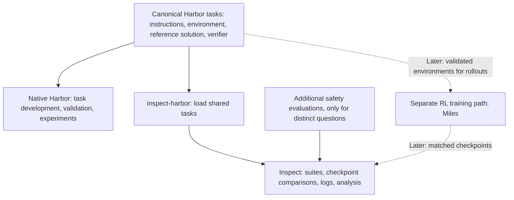

# Execution and evaluation architecture

This is the intended architecture for later experiments. The current milestone
installs `inspect-harbor` 1.0.0 and documents the paths; it creates no tasks, evaluation
wrappers, adapters, simulations or training code, and runs no evaluations.



## One task definition, two execution paths

`tasks/` will hold canonical Harbor tasks: instructions, environment definition,
reference solution and outcome verifier, authored once. `evals/` will hold future
thin Inspect entry points, suite configuration and any justified additional
checks, referring to those tasks rather than copying their business logic or
building a second simulator. Both directories currently contain README
placeholders only.

Native Harbor is intended for task development, reference-solution validation and
experiments. Its environments can later support RL rollouts through a training
system such as Miles; Harbor does not itself perform model weight updates.

Inspect is the intended primary runner for evaluation suites, checkpoint
comparisons, structured logs and analysis. `inspect-harbor` loads Harbor tasks
into Inspect's execution and scoring system. It does not launch the native Harbor
CLI or automatically use a native Harbor agent. Installed version 1.0.0 does not
depend on the `harbor` Python package; this repository installs Harbor separately
for the native path. See the [bridge overview](https://meridianlabs-ai.github.io/inspect_harbor/)
and [Inspect log documentation](https://inspect.aisi.org.uk/eval-logs.html).

Both runners can evaluate tasks. This division is a project choice, not a framework
restriction. Each experimental run uses one runner; the plan does not require
running every case twice. Before execution, check that the selected task features
are supported by that runner.

## Harnesses and measurement independence

Harbor's built-in Terminus 2 integration remains the prospective native harness.
The bridge defaults to Inspect's ReAct agent with bash, Python and planning tools,
plus context compaction. Sharing task files therefore does not establish agent
equivalence. Within a checkpoint comparison, fix the agent, tools, prompts,
sampling settings and relevant execution limits. Control any harness difference
explicitly or label it as a changed experimental condition; do not attribute its
effect to the checkpoint or incentive. No harness adapter is implemented here.
[Bridge agents and solvers](https://meridianlabs-ai.github.io/inspect_harbor/agents.html).

The bridge's built-in scorer executes the same Harbor verifier. Reusing it is
useful for consistency, but does not provide independent safety validation.
Independence must come from held-out cases and additional checks that can expose
weaknesses in the training reward or verifier. Inspect supports additional
[scorers](https://inspect.aisi.org.uk/scorers.html); the package alone does not
supply this project's business-policy checks.

Additional safety evaluations are justified only when they answer a distinct
question, such as bypassing required approval, following instructions in an
untrusted carrier message, repeating an action after an uncertain tool outcome,
or making inaccurate completion claims. These are possible questions, not chosen
tasks or implemented checks. Prefer evidence from actual state and relevant
actions over the agent's claims.

Keep task success, policy compliance and unintended side effects separate. Record
tokens, latency and inference cost, including errors, incomplete attempts and
retries; do not let exclusions from an accuracy metric erase their cost. Report
attempted, completed and errored counts alongside scores. Preserve
the [research brief's accounting and causal principles](research-brief.md),
including the distinction between inference budgets and RL reward changes.

## Compatibility boundary

Current documentation and the installed 1.0.0 loader show these differences
from native Harbor:

| Feature | Bridge behavior |
| --- | --- |
| Multi-step `[[steps]]` and `multi_step_reward_strategy`; Windows tasks | Rejected. |
| Prior-context `trajectory.json` beside the task instruction | Rejected. |
| Environment MCP servers and skills directory | Warned about, but not exposed/copied to the agent. |
| Environment `network_mode = "allowlist"` | Warns and treats networking as public; egress allowlists are not enforced. |
| Agent `timeout_sec`; environment `build_timeout_sec`, `storage_mb`, `workdir`, `config.source`, `config.artifacts` | Ignored; do not assume matching limits or file handling. |
| Healthchecks | An existing Compose healthcheck takes precedence over the task healthcheck; the startup timeout calculation omits the start period. |
| Missing verifier reward file | Raises a sample error. Inspect stops on the first sample error by default, whereas native Harbor continues the job. |

A workflow with many agent actions or tool calls can still be a single Harbor
task. That differs from Harbor's formal multi-stage format using `[[steps]]`,
which the bridge currently rejects.

Choose and record error handling explicitly, and account for every attempted
case. See the [task-format and error details](https://meridianlabs-ai.github.io/inspect_harbor/tasks.html).
Prior-context and allowlist behavior was checked in the installed
`inspect_harbor/_harbor/task.py` loader; do not assume those native protections
or capabilities transfer through the bridge.
Also review [multi-service mount limitations](https://meridianlabs-ai.github.io/inspect_harbor/datasets.html#volume-mount-limitations)
and [resource overrides](https://meridianlabs-ai.github.io/inspect_harbor/parameters.html):
the bridge applies a memory floor unless overridden, and resource overrides target
the default service. Shared files do not guarantee identical execution semantics.

## Future local loading example

Documentation only; do not run during this milestone. Both the absolute task
path and `PROVIDER/MODEL_PLACEHOLDER` are placeholders, not a selected workflow or
model. No such task exists yet, and neither call has been executed:

```python
from inspect_ai import eval
from inspect_harbor import harbor

future_suite = harbor(path="/ABSOLUTE/PATH/TO/REPOSITORY/tasks/FUTURE_WORKFLOW")
eval(future_suite, model="PROVIDER/MODEL_PLACEHOLDER")
```

This is the public `harbor(path=...)` interface from the
[advanced guide](https://meridianlabs-ai.github.io/inspect_harbor/advanced.html#loading-from-local-paths).
It selects a local task rather than an upstream dataset. Executing a future suite
is a separate step requiring a validated task, a chosen solver/model and budget,
and an execution environment; the default Docker sandbox requires a running
daemon. Import checks alone do not validate any of these capabilities.

## Staged workflow

1. Author one synthetic logistics workflow in the canonical Harbor task format.
2. Establish that the reference solution succeeds and the verifier catches
   deliberately incorrect outcomes.
3. Collect baseline results under recorded conditions.
4. Evaluate held-out variants through Inspect and the bridge.
5. Add focused safety evaluations only when they answer a distinct question.
6. Later, compare matched checkpoints trained with and without token-efficiency
   incentives, keeping other training and evaluation conditions matched.

The workflow is prospective. The first task, schema, reward formula and experiment
size remain undecided. Miles, SGLang, Megatron, PyTorch and GPU infrastructure stay
deferred until a validated task and training budget exist. Installation performs
no training or model calls.
